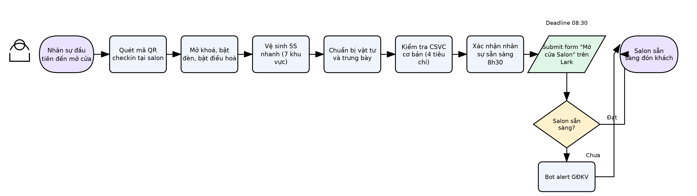
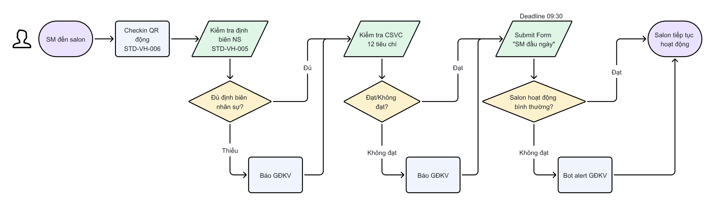

# \[SOP-VH-001] Quy trình Mở cửa hàng ngày Salon

## THÔNG TIN CHUNG

| **Mã quy trình**    | SOP-VH-001                            |
| ------------------- | ------------------------------------- |
| **Tên quy trình**   | Quy trình Mở cửa hàng ngày Salon      |
| **Phiên bản**       | 2.1                                   |
| **Ngày ban hành**   | 22/04/2026                            |
| **Ngày hiệu lực**   | 29/07/2026                            |
| **Bộ phận sở hữu**  | Khối Vận hành                         |
| **Người soạn thảo** | GĐ BP Vận hành Salon                  |
| **Người phê duyệt** | Nguyễn Huy Hoàng — Giám đốc Điều hành |

***

## 1. MỤC ĐÍCH

Quy trình Mở cửa hàng ngày Salon quy định 2 công việc tách rời diễn ra vào đầu mỗi ngày vận hành:

* **(A) Mở cửa vật lý** — đảm bảo salon sạch, đủ vật tư, sáng đèn, có người sẵn sàng đón khách trước 8:30.

* **(B) SM đầu ngày** — SM đích danh xác nhận salon đủ điều kiện vận hành theo tiêu chuẩn: định biên nhân sự, CSVC 12 tiêu chí; leo thang nếu cần.

Hai công việc này là độc lập: (A) do người đến sớm nhất thực hiện, (B) do SM thực hiện sau — không phải cùng một người, không phải cùng một form.

***

## 2. PHẠM VI ÁP DỤNG

* **Áp dụng cho:** Toàn bộ salon công ty trong hệ thống 30Shine.

* **Đối tượng thực hiện:** (A) NV đầu tiên đến salon; (B) SM đích danh.

* **Không áp dụng:** Salon nhượng quyền (franchise).

***

## 3. ĐỊNH NGHĨA & THUẬT NGỮ

| **Thuật ngữ**       | **Định nghĩa**                                                                                                                                |
| ------------------- | --------------------------------------------------------------------------------------------------------------------------------------------- |
| Mở cửa vật lý       | Hành động NV đầu tiên đến salon quét mã QR checkin, mở khóa, bật đèn, vệ sinh 5S, chuẩn bị vật tư, kiểm tra CSVC cơ bản và submit Form "Mở cửa salon" trước 8:30. |
| SM đầu ngày         | Quy trình SM đích danh xác nhận định biên nhân sự, CSVC 12 tiêu chí, leo thang nếu cần, và submit Form "SM đầu ngày" trước 9:30.              |
| NV đầu tiên         | Nhân sự có mặt đầu tiên tại salon trong ngày — có thể là SM, Supporter, Stylist, hoặc Skinner.                                                |
| QR checkin mở cửa   | Hành động NV đầu tiên quét mã QR động đặt tại salon **ngay khi đến, trước khi bắt đầu checklist mở cửa vật lý** (Bước A1–A6). Timestamp quét QR là căn cứ chính thức xác nhận salon mở cửa đúng giờ — độc lập với thời điểm submit Form, không thay thế cho QR checkin của SM (B1, theo STD-VH-006). |
| Định biên tối thiểu | Số Stylist và Skinner tối thiểu theo STD-VH-005: max(≥50% biên chế, 2 người) cho ngày thường (T2–T6); ≥80% biên chế cho cuối tuần (T7–CN).    |
| CSVC 12 tiêu chí    | Bộ tiêu chí cơ sở vật chất tối thiểu SM xác nhận mỗi đầu ngày — xem STD-VH-001 mục 5.2 Phần B.                                                |
| Tick hình thức      | Hành vi đánh dấu hoàn thành checklist không tương ứng với hành động thực tế — vi phạm tiêu chuẩn vận hành.                                    |

***

## 4. TÀI LIỆU LIÊN QUAN

| **Mã tài liệu** | **Tên tài liệu**                                                                | **Loại** |
| --------------- | ------------------------------------------------------------------------------- | -------- |
| STD-VH-001      | Tiêu chuẩn Sẵn sàng mở cửa Salon                                                | STD      |
| STD-VH-005      | Tiêu chuẩn Định biên Nhân sự Salon                                              | STD      |
| STD-VH-006      | Tiêu chuẩn Số lần Hiện diện Thực tế tại Salon                                   | STD      |
| STD-VH-007      | Tiêu chuẩn Xử lý Bất thường & Escalation                                        | STD      |
| SOP-VH-003      | Quy trình Đóng cửa hàng ngày Salon                                              | SOP      |
| WI-VH-001       | Hướng dẫn trao đổi qua nhóm chat và Hotline nội bộ (có §8 Ủy quyền khi SM nghỉ) | WI       |
| PO-VH-002       | Chính sách Trừ thưởng Vận hành                                                  | PO       |

***

## 5. QUY TRÌNH CHI TIẾT

***

### PHẦN A — MỞ CỬA VẬT LÝ (NV đầu tiên đến salon)

**Ai thực hiện:** NV đầu tiên có mặt tại salon — có thể là SM, Supporter, Stylist, hoặc Skinner.

**Deadline:** Submit Form "Mở cửa salon" trên Lark **trước 8:30**.

**Tinh thần:** Salon sẵn sàng đón khách lúc 8:30 — sạch, đủ đồ, sáng đèn, có người tiếp khách. Quét QR checkin trước, làm checklist sau — mốc QR là căn cứ xác nhận mở cửa đúng giờ.

| **Bước** | **Nội dung thực hiện**                                                                                                                                                                                                                                                                                                                                          | **Output**                           |
| -------- | --------------------------------------------------------------------------------------------------------------------------------------------------------------------------------------------------------------------------------------------------------------------------------------------------------------------------------------------------------------- | ------------------------------------ |
| A0       | **Quét mã QR checkin tại salon**&#xA;— Ngay khi đến salon, quét mã QR động đặt tại salon — thực hiện **trước khi** bắt đầu Bước A1.&#xA;— Không quét QR checkin = không có căn cứ xác nhận mốc mở cửa đúng giờ, kể cả khi Form "Mở cửa salon" đã submit đủ.                                                                                                    | Mốc thời gian mở cửa được ghi nhận   |
| A1       | **Đến salon, mở khóa, bật đèn, bật điều hòa**&#xA;— Mở khóa cửa chính và cửa phụ (nếu có).&#xA;— Bật toàn bộ đèn, bật điều hòa.&#xA;— Kiểm tra nhanh không có vật lạ, không có nguy cơ an toàn rõ ràng.                                                                                                                                                         | Salon được mở khóa, đèn sáng         |
| A2       | **Vệ sinh 5S nhanh — sẵn sàng đón khách**&#xA;— Quét/lau sàn toàn salon.&#xA;— Lau ghế cắt, ghế chờ — không còn tóc tồn.&#xA;— Lau giường gội, kiểm tra bồn gội thoát nước.&#xA;— Lau gương — không bám nước, bụi.&#xA;— Vệ sinh khu WC: sạch, đủ giấy, xà phòng.&#xA;— Lau cửa kính, kiểm tra mặt tiền.&#xA;— Gọn khu nội bộ: đồ sạch/bẩn riêng, lối đi thông. | Toàn bộ khu vực đạt 5S trước 8:30    |
| A3       | **Chuẩn bị vật tư và trưng bày**&#xA;— Gấp khăn sạch đủ cho ngày.&#xA;— Pha nước mời khách.&#xA;— Kiểm tra vật tư tiêu hao (dầu gội, dầu xả): đủ cho ngày.&#xA;— Bày sản phẩm trưng bày đúng vị trí, có giá niêm yết.&#xA;— Treo/bày ấn phẩm marketing, bảng giá.                                                                                               | Vật tư và trưng bày sẵn sàng         |
| A4       | **Kiểm tra CSVC cơ bản**&#xA;— Đèn/ánh sáng: hoạt động toàn salon.&#xA;— Điều hòa: đã bật, hoạt động.&#xA;— Nước (nóng + lạnh): hoạt động, không rò.&#xA;— Máy POS/thanh toán: hoạt động.&#xA;— Ghi nhận lỗi nếu có.                                                                                                                                            | CSVC cơ bản được xác nhận            |
| A5       | **Xác nhận nhân sự sẵn sàng 8:30**&#xA;— Có ít nhất 1 Supporter hoặc SM sẵn sàng tiếp khách tại lễ tân.&#xA;— Có ít nhất 1 Stylist sẵn sàng cắt.&#xA;— Có ít nhất 1 Skinner sẵn sàng gội.                                                                                                                                                                       | Đủ người đón khách lúc 8:30          |
| A6       | **Submit Form "Mở cửa salon" trên Lark trước 8:30**&#xA;— Điền đầy đủ các mục theo form.&#xA;— Nếu có hạng mục chưa đạt: ghi rõ lý do — form tự động alert GĐKV.&#xA;— Không để trống bất kỳ mục bắt buộc nào.&#xA;— Người submit Form phải là người đã quét QR checkin ở Bước A0 — các bước A1–A5 có thể có NV khác hỗ trợ.                                                                                                                                                  | 1 form hợp lệ được submit trước 8:30 |

***

### PHẦN B — SM ĐẦU NGÀY (SM đích danh)

**Ai thực hiện:** SM đích danh khi đi làm. Khi SM off (nghỉ phép/nghỉ ốm/công tác), SM ủy quyền theo **WI-VH-001 §8** (Nguyên tắc ủy quyền khi SM nghỉ) — SM chịu 100% trách nhiệm về tính chính xác.

**Deadline:** Submit Form "SM đầu ngày" trên Lark **trước 9:30**.

**Tinh thần:** SM xác nhận salon đủ tiêu chuẩn hoạt động — định biên đủ, CSVC đạt 12 tiêu chí; leo thang ngay nếu thiếu.

| **Bước** | **Nội dung thực hiện**                                                                                                                                                                                                                                                                                                                                                                                                                                                                                                              | **Output**                           |
| -------- | ----------------------------------------------------------------------------------------------------------------------------------------------------------------------------------------------------------------------------------------------------------------------------------------------------------------------------------------------------------------------------------------------------------------------------------------------------------------------------------------------------------------------------------- | ------------------------------------ |
| B1       | **SM checkin QR động tại salon** (theo STD-VH-006)&#xA;— SM checkin QR động trước 11:00 (hoặc sớm hơn nếu SM đến trước).&#xA;— Checkin QR là xác nhận SM có mặt thực tế — điều kiện để Form "SM đầu ngày" hợp lệ.                                                                                                                                                                                                                                                                                                                   | SM đã checkin QR tại salon           |
| B2       | **Kiểm tra định biên nhân sự trong ngày (STD-VH-005)**&#xA;— Rà soát số Stylist và Skinner thực tế đi làm hôm nay.&#xA;— Đối chiếu với ngưỡng tối thiểu theo STD-VH-005.&#xA;— Nếu thiếu: đánh giá ngay khả năng bù đắp nội bộ.                                                                                                                                                                                                                                                                                                     | Trạng thái định biên được xác nhận   |
| B3       | **Kiểm tra CSVC 12 tiêu chí** (theo STD-VH-001 mục 5.2 Phần B + STD-TNKH-004)&#xA;— Giường gội hoạt động ≥ 2.&#xA;— Ghế cắt hoạt động ≥ 2.&#xA;— Cửa ra vào mở/đóng bình thường.&#xA;— Hệ thống điện ổn định, không dây hở.&#xA;— Đèn khu cắt + gội đủ sáng.&#xA;— Điều hòa hoạt động ≥ 1.&#xA;— Hệ thống nước hoạt động, áp lực đủ.&#xA;— Máy sấy hoạt động ≥ 2.&#xA;— Tông đơ ≥ số Stylist trong ca.&#xA;— POS/thanh toán hoạt động.&#xA;— Vật tư dịch vụ đủ cho ngày.&#xA;— An toàn (không điện hở, nước rò, sàn trơn, vật rơi). | 12 tiêu chí CSVC được xác nhận       |
| B4       | **Leo thang nếu cần (STD-VH-007)**&#xA;— Thiếu nhân sự: báo GĐKV kèm số lượng thiếu, vị trí.&#xA;— CSVC không đạt: ghi mô tả lỗi, báo GĐKV.&#xA;— Chờ phê duyệt GĐKV nếu cần mở cửa ngoại lệ.                                                                                                                                                                                                                                                                                                                                       | GĐKV được thông báo nếu có vấn đề    |
| B5       | **Submit Form "SM đầu ngày" trên Lark trước 9:30**&#xA;— Điền đầy đủ theo form: định biên, CSVC 12 tiêu chí, kết luận trạng thái.&#xA;— Nếu có tiêu chí không đạt: ghi người phê duyệt ngoại lệ (GĐKV hoặc GĐ Khối VH).&#xA;— Không để trống bất kỳ mục bắt buộc nào.                                                                                                                                                                                                                                                               | 1 form hợp lệ được submit trước 9:30 |

***

### 5.2 Xử lý các luồng ngoại lệ

**Luồng 1 — Form "Mở cửa salon" chưa đạt (Z1 = Chưa sẵn sàng)**

* Bot alert ngay GĐKV.

* NV báo đồng thời SM (nếu SM chưa đến).

* SM xử lý hoặc chỉ đạo xử lý, ghi nhận kết quả lên nhóm chat cụm.

**Luồng 2 — Thiếu nhân sự đầu ngày**

* SM đánh giá: đủ ngưỡng tối thiểu (STD-VH-005) → có thể vận hành, ghi nhận vào form.

* Không đủ ngưỡng → báo GĐKV ngay, chờ phê duyệt hoặc hỗ trợ điều phối.

**Luồng 3 — CSVC lỗi nghiêm trọng (không đủ điều kiện vận hành)**

* SM dừng quyết định vận hành bình thường.

* Báo GĐKV ngay theo STD-VH-007.

* Không được vận hành khi chưa có phê duyệt GĐKV.

**Luồng 4 — SM đến sau 9:30 (có lý do)**

* SM báo GĐKV lý do trước hoặc ngay khi phát sinh.

* Submit Form "SM đầu ngày" ngay khi đến — dù trễ.

* GĐKV ghi nhận ngoại lệ.

**Luồng 5 — Sự cố bất khả kháng (thiên tai, lệnh hành chính)**

| **Tình huống**                         | **Cách xử lý**                                | **Người quyết định** |
| -------------------------------------- | --------------------------------------------- | -------------------- |
| Mưa bão, ngập nước, gió giật nguy hiểm | Không vận hành. Ghi nhận ngoại lệ + báo GĐKV. | SM → GĐKV            |
| Mất điện/nước toàn khu vực kéo dài     | Không vận hành. Báo GĐKV, chờ chỉ đạo.        | SM → GĐKV            |
| Sự cố an ninh nghiêm trọng             | Dừng mở cửa ngay lập tức, báo GĐKV.           | SM                   |
| Chỉ đạo đặc biệt từ Công ty            | Thực hiện theo chỉ đạo, ghi nhận ngoại lệ.    | GĐKV / Công ty       |

**Luồng 6 — Không thể quét QR checkin (lỗi mã QR, mất mạng, mất điện)**

* Ghi rõ lý do trong mục ghi chú Form "Mở cửa salon".

* Báo GĐKV ngay.

* GĐKV ghi nhận ngoại lệ — không tính vi phạm nếu lý do khách quan và có bằng chứng kèm theo.

***

## 6. LƯU ĐỒ QUY TRÌNH (2 track song song)

1. Quy trình mở cửa vật lý

* Quy trình checklist SM đầu ngày

> Lưu đồ Phần A đã cập nhật bước A0 (quét QR checkin trước khi làm checklist mở cửa).

***

## 7. VAI TRÒ & TRÁCH NHIỆM (RACI)

| **Vị trí / Bộ phận**    | **Vai trò** | **Mô tả**                                                                          |
| ----------------------- | ----------- | ---------------------------------------------------------------------------------- |
| NV đầu tiên đến salon   | R (Phần A)  | Thực hiện vệ sinh 5S, chuẩn bị vật tư, kiểm tra CSVC cơ bản, submit Form mở cửa.   |
| Quản lý Salon (SM)      | R (Phần B)  | Kiểm tra định biên, CSVC 12 tiêu chí, leo thang nếu cần, submit Form SM đầu ngày.  |
| Giám đốc Khu vực (GĐKV) | A           | Nhận alert từ bot, phê duyệt ngoại lệ, điều phối khi thiếu NS hoặc CSVC không đạt. |
| BP Vận hành Hệ thống    | C           | Giám sát dữ liệu form, phát hiện bất thường, hậu kiểm.                             |
| Nhân sự salon           | I           | Thực hiện vệ sinh theo phân công, xác nhận sẵn sàng trước 8:30.                    |

***

## 8. CHỈ SỐ ĐO LƯỜNG & SLA

| **Chỉ số**                                   | **Mục tiêu** | **Đơn vị đo** | **Nguồn dữ liệu**     | **Người giám sát** |
| -------------------------------------------- | ------------ | ------------- | --------------------- | ------------------ |
| % NV checkin QR mở cửa trước 8:30 — căn cứ xác nhận mở cửa đúng giờ | ≥ 95%        | Salon × ngày  | QR log / timestamp    | GĐKV               |
| % Form "Mở cửa salon" submit trước 8:30      | ≥ 95%        | Salon × ngày  | Lark Form / timestamp | GĐKV               |
| % Form "SM đầu ngày" submit trước 9:30       | ≥ 95%        | Salon × ngày  | Lark Form / timestamp | GĐKV               |
| % Form hợp lệ (không bỏ trống, đúng thực tế) | ≥ 95%        | Salon × ngày  | Lark Form             | BP VH Hệ thống     |
| Số ngày vận hành khi chưa đủ điều kiện       | 0            | Lần / tháng   | Lark Form + hậu kiểm  | GĐKV               |

***

## 9. XỬ LÝ VI PHẠM

| **Mức độ**   | **Mô tả**                                                    | **Hành động**                                   | **Thời hạn**  |
| ------------ | ------------------------------------------------------------ | ----------------------------------------------- | ------------- |
| Nhẹ          | Form trễ, thiếu 1 nội dung, lần đầu                          | Nhắc nhở, hướng dẫn lại                         | Ngay          |
| Trung bình   | Tick hình thức, bằng chứng không hợp lệ, lặp lại             | Đào tạo lại, cảnh báo chính thức                | ≤ 48h         |
| Nghiêm trọng | Vận hành khi chưa đủ điều kiện, báo cáo sai, giả mạo dữ liệu | Xử lý theo \[PO] Chính sách Trừ thưởng Vận hành | Theo quy định |

***

## 10. LỊCH SỬ THAY ĐỔI

| **Phiên bản** | **Ngày**   | **Nội dung thay đổi**                                                             | **Người thay đổi**   |
| ------------- | ---------- | --------------------------------------------------------------------------------- | -------------------- |
| 1.0           | 22/04/2026 | Ban hành lần đầu                                                                  | GĐ BP Vận hành Salon |
| 2.0           | 22/04/2026 | Tái cấu trúc theo định hướng v4: tách 2 phần A (mở cửa vật lý) và B (SM đầu ngày) | GĐ BP Vận hành Salon |
| 2.1           | 29/07/2026 | Bổ sung Bước A0 — NV đầu tiên quét mã QR checkin tại salon trước khi làm checklist mở cửa (A1–A6); mốc QR là căn cứ xác nhận salon mở cửa đúng giờ | BP Vận hành Hệ thống |
