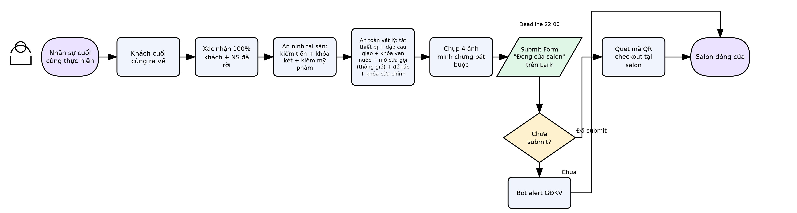
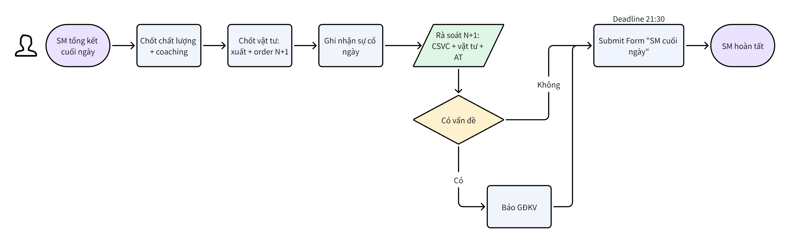

# \[SOP-VH-003] Quy trình Đóng cửa hàng ngày Salon

## THÔNG TIN CHUNG

| **Mã quy trình**    | SOP-VH-003                            |
| ------------------- | ------------------------------------- |
| **Tên quy trình**   | Quy trình Đóng cửa hàng ngày Salon    |
| **Phiên bản**       | 2.1                                   |
| **Ngày ban hành**   | 22/04/2026                            |
| **Ngày hiệu lực**   | 29/07/2026                            |
| **Bộ phận sở hữu**  | Khối Vận hành                         |
| **Người soạn thảo** | GĐ BP Vận hành Salon                  |
| **Người phê duyệt** | Nguyễn Huy Hoàng — Giám đốc Điều hành |

***

## 1. MỤC ĐÍCH

Quy trình Đóng cửa hàng ngày Salon quy định 2 công việc tách rời diễn ra vào cuối mỗi ngày vận hành:

* **(A) SM cuối ngày** — SM đích danh chốt chất lượng, vật tư, sự cố, rà soát N+1, và submit Form "SM cuối ngày" trước 21:30.

* **(B) Đóng cửa vật lý** — NV cuối cùng rời salon thực hiện an ninh tài sản, an toàn vật lý, chụp ảnh minh chứng, và submit Form "Đóng cửa salon" — soft 22:30 / hard 02:00 sáng hôm sau.

Hai việc này độc lập: SM không nhất thiết phải là người cuối cùng rời salon. Checklist SM cuối ngày chốt trước 21:30; đóng cửa vật lý hoàn tất — soft 22:30 / hard 02:00 sáng hôm sau — đây là **2 việc khác nhau, không mâu thuẫn**.

***

## 2. PHẠM VI ÁP DỤNG

* **Áp dụng cho:** Toàn bộ salon công ty trong hệ thống 30Shine.

* **Đối tượng thực hiện:** (A) SM đích danh; (B) NV cuối cùng rời salon.

* **Không áp dụng:** Salon nhượng quyền (franchise).

***

## 3. ĐỊNH NGHĨA & THUẬT NGỮ

| **Thuật ngữ**         | **Định nghĩa**                                                                                                                                                                        |
| --------------------- | ------------------------------------------------------------------------------------------------------------------------------------------------------------------------------------- |
| SM cuối ngày          | Quy trình SM đích danh chốt ngày: chất lượng, coaching, vật tư, sự cố, rà soát N+1. Submit Form "SM cuối ngày" trước 21:30.                                                           |
| Đóng cửa vật lý       | Quy trình NV cuối cùng rời salon thực hiện: kiểm soát tài sản, an toàn điện/nước, khóa cửa, chụp ảnh minh chứng, submit Form "Đóng cửa salon", quét QR checkout — soft 22:30 / hard 02:00 sáng hôm sau. |
| NV cuối cùng          | Nhân sự cuối cùng thực sự rời salon — có thể là SM, Supporter, Stylist, hoặc Skinner.                                                                                                 |
| QR checkout đóng cửa  | Hành động NV cuối cùng quét mã QR động đặt tại salon **sau khi** đã hoàn tất checklist đóng cửa vật lý và submit Form "Đóng cửa salon" (Bước B1–B5), ngay trước khi rời đi. Timestamp quét QR là căn cứ chính thức xác nhận salon đóng cửa đúng giờ — độc lập với thời điểm submit Form. |
| N+1                   | Ngày vận hành kế tiếp (ngày mai).                                                                                                                                                     |
| Rà soát N+1 (SM)      | SM xem xét và xác nhận CSVC, vật tư, an toàn đủ điều kiện cho N+1 — ghi nhận trong Form SM cuối ngày trước 21:30.                                                                     |
| Chốt chấm công N+1    | SM submit lịch chấm công N+1 trên ERP trước 22:00 — việc riêng trong SOP-VH-004, không cùng là "SM cuối ngày".                                                                        |
| Ảnh minh chứng        | 4 ảnh bắt buộc upload khi submit Form "Đóng cửa salon": két sắt, cầu giao, van nước, cửa chính.                                                                                       |
| Bằng chứng hợp lệ     | Hình ảnh phản ánh đúng trạng thái thực tế tại thời điểm đóng cửa. Không dùng lại ảnh cũ, không chụp đối phó, có thể truy vết thời gian.                                               |
| Ủy quyền SM cuối ngày | Khi SM off (nghỉ phép/nghỉ ốm), SM ủy quyền cho 1 người thực hiện Form SM cuối ngày — ghi rõ tên người được ủy quyền và lý do.                                                        |

***

## 4. TÀI LIỆU LIÊN QUAN

| **Mã tài liệu** | **Tên tài liệu**                                                                | **Loại** |
| --------------- | ------------------------------------------------------------------------------- | -------- |
| STD-VH-003      | Tiêu chuẩn Sẵn sàng đóng cửa Salon                                              | STD      |
| STD-VH-004      | Tiêu chuẩn Sẵn sàng hoạt động ngày N+1 (Công ty)                                | STD      |
| STD-VH-005      | Tiêu chuẩn Định biên Nhân sự Salon                                              | STD      |
| STD-VH-006      | Tiêu chuẩn Số lần Hiện diện Thực tế tại Salon                                   | STD      |
| STD-VH-007      | Tiêu chuẩn Xử lý Bất thường & Escalation                                        | STD      |
| SOP-VH-001      | Quy trình Mở cửa hàng ngày Salon                                                | SOP      |
| SOP-VH-004      | Quy trình Chấm công                                                             | SOP      |
| SOP-VH-005      | Quy trình Điều chuyển nhân sự ngày N+1                                          | SOP      |
| WI-VH-001       | Hướng dẫn trao đổi qua nhóm chat và Hotline nội bộ (có §8 Ủy quyền khi SM nghỉ) | WI       |
| PO-VH           | Chính sách Trừ thưởng Vận hành                                                  | PO       |

***

## 5. QUY TRÌNH CHI TIẾT

***

### PHẦN A — SM CUỐI NGÀY (SM đích danh — deadline 21:30)

**Ai thực hiện:** SM đích danh khi đi làm. Khi SM off (nghỉ phép/nghỉ ốm/công tác), SM ủy quyền theo **WI-VH-001 §8** (Nguyên tắc ủy quyền khi SM nghỉ) — SM chịu 100% trách nhiệm về tính chính xác.

**Deadline:** Submit Form "SM cuối ngày" trên Lark **trước 21:30**.

**Tinh thần:** Chốt ngày — chất lượng, coaching, vật tư, sự cố. Rà soát N+1 một lần trước khi form đóng.

| **Bước** | **Nội dung thực hiện**                                                                                                                                                                                                                                                                                    | **Output**                                    |
| -------- | --------------------------------------------------------------------------------------------------------------------------------------------------------------------------------------------------------------------------------------------------------------------------------------------------------- | --------------------------------------------- |
| A1       | **Chốt chất lượng dịch vụ ngày**&#xA;— Ghi số feedback tiêu cực phát sinh trong ngày.&#xA;— Ghi nhận coaching: mã NV + nội dung coaching và kết quả (nếu có).&#xA;— Nếu không có coaching: ghi "Không".                                                                                                   | Dữ liệu chất lượng được chốt                  |
| A2       | **Chốt vật tư ngày**&#xA;— Xác nhận đã xuất vật tư định lượng hôm nay.&#xA;— Xác nhận đã order vật tư dùng chung cho ngày mai (hoặc ghi "Không cần order thêm" nếu đủ).                                                                                                                                   | Tình trạng vật tư ngày được ghi nhận          |
| A3       | **Ghi nhận sự cố trong ngày**&#xA;— Sự cố khách quan (thời tiết, mất điện khu vực, mất nước khu vực...): Không có / Có → mô tả.&#xA;— Sự cố CSVC ảnh hưởng kinh doanh: Không có / Có → mô tả.                                                                                                             | Sự cố ngày được ghi nhận đầy đủ               |
| A4       | **Rà soát N+1 — CSVC, vật tư, an toàn (STD-VH-004 mục 5.2–5.4)**&#xA;— CSVC đủ điều kiện vận hành ngày mai? (Đủ / Có thiết bị lỗi).&#xA;— Vật tư dịch vụ đủ cho ngày mai? (Đủ / Không đủ).&#xA;— An toàn điện/nước/sàn? (An toàn / Có nguy cơ).&#xA;— Nếu bất kỳ mục ≠ OK: mô tả và xác nhận đã báo GĐKV. | N+1 được rà soát, GĐKV được thông báo nếu cần |
| A5       | **Submit Form "SM cuối ngày" trên Lark trước 21:30**&#xA;— Điền đầy đủ các mục theo form.&#xA;— Nếu ủy quyền: ghi tên người được ủy quyền + lý do.&#xA;— Không để trống bất kỳ mục bắt buộc nào.                                                                                                          | 1 form hợp lệ được submit trước 21:30         |

***

### PHẦN B — ĐÓNG CỬA VẬT LÝ (NV cuối cùng rời salon — soft deadline 22:00)

**Ai thực hiện:** NV cuối cùng thực sự rời salon — có thể là SM, Supporter, Stylist, hoặc Skinner.

**Deadline:** Submit Form "Đóng cửa salon" trên Lark — **soft deadline 22:00**; bot flag salon chưa nộp lúc 22:30. Form vẫn nhận sau 22:00.

**Tinh thần:** 0 THỎA HIỆP. An toàn tuyệt đối. Phải chụp ảnh minh chứng. Làm checklist trước, quét QR checkout sau — mốc QR là căn cứ xác nhận đóng cửa đúng giờ.

| **Bước** | **Nội dung thực hiện**                                                                                                                                                                                                                                                                                                     | **Output**                            |
| -------- | -------------------------------------------------------------------------------------------------------------------------------------------------------------------------------------------------------------------------------------------------------------------------------------------------------------------------- | ------------------------------------- |
| B1       | **Xác nhận hết khách, hết nhân sự khu dịch vụ**&#xA;— Rà soát toàn bộ khu vực: cắt, gội, chờ, WC, hành lang.&#xA;— Xác nhận 100% khách đã rời salon.&#xA;— Không còn nhân sự trong khu vực dịch vụ.                                                                                                                        | Salon trống hoàn toàn                 |
| B2       | **An ninh tài sản**&#xA;— Kiểm đếm tiền mặt, đối soát tồn quỹ, khóa két.&#xA;— Kiểm đếm mỹ phẩm/vật tư có giá trị theo danh mục.                                                                                                                                                                                           | Tài sản được kiểm soát đầy đủ         |
| B3       | **An toàn vật lý — 6 bước bắt buộc theo thứ tự**&#xA;1\. Tắt tất cả thiết bị điện (trừ tủ lạnh và camera giám sát).&#xA;2\. Dập cầu giao điện chính.&#xA;3\. Khóa van nước chính.&#xA;4\. Mở cửa phòng gội để thông gió, chống ẩm mốc.&#xA;5\. Đổ rác, buộc túi rác.&#xA;6\. Khóa tất cả cửa (cửa chính + cửa phụ nếu có). | Salon an toàn vật lý 100%             |
| B4       | **Chụp ảnh minh chứng — 4 ảnh bắt buộc**&#xA;— Ảnh 1: Két sắt đã khóa.&#xA;— Ảnh 2: Cầu giao điện đã dập.&#xA;— Ảnh 3: Van nước đã khóa.&#xA;— Ảnh 4: Cửa chính đã khóa (chụp từ bên ngoài).                                                                                                                               | 4 ảnh sẵn sàng upload                 |
| B5       | **Submit Form "Đóng cửa salon" trên Lark — trước 22:00**&#xA;— Điền đầy đủ các mục theo form.&#xA;— Upload đủ 4 ảnh minh chứng.&#xA;— Thiếu bất kỳ ảnh nào = form không hợp lệ.                                                                                                                                            | 1 form hợp lệ được submit trước 22:00 |
| B6       | **Quét mã QR checkout tại salon**&#xA;— Sau khi hoàn tất Bước B1–B5 (đã submit Form "Đóng cửa salon"), quét mã QR động đặt tại salon **trước khi rời đi**.&#xA;— Không quét QR checkout = không có căn cứ xác nhận mốc đóng cửa đúng giờ, kể cả khi Form đã submit đủ.&#xA;— Người quét QR ở bước này bắt buộc là người vừa submit Form "Đóng cửa salon" ở Bước B5 — các bước B1–B4 có thể có NV khác hỗ trợ, nhưng không đổi người submit Form và người quét QR.                                                     | Mốc thời gian đóng cửa được ghi nhận  |

***

### 5.2 Xử lý các luồng ngoại lệ

**Luồng 1 — SM off (nghỉ có kế hoạch / đột xuất)**

* SM ủy quyền theo thứ tự ưu tiên tại **WI-VH-001 §8.2** (Stylist/Supporter trưởng ca → SM cụm → GĐKV).

* Nếu SM nghỉ đột xuất không kịp ủy quyền: GĐKV có quyền chỉ định khẩn cấp, SM hậu kiểm khi quay lại.

* Ghi rõ tên người ủy quyền + lý do trong form.

* SM off ≥ 3 ngày liên tục: GĐKV chỉ định Acting SM cố định (theo WI-VH-001 §8.3).

**Luồng 2 — CSVC N+1 có thiết bị lỗi**

* SM ghi mô tả lỗi vào form (mục D).

* Xác nhận đã báo GĐKV.

* GĐKV kích hoạt xử lý theo STD-VH-007.

**Luồng 3 — Không thể submit form trước 22:00 do yếu tố khách quan**

| **Tình huống**                       | **Cách xử lý**                                                     | **Người quyết định** |
| ------------------------------------ | ------------------------------------------------------------------ | -------------------- |
| Mất điện/mất mạng không thể gửi form | Ghi nhận lý do, gửi ngay khi có điều kiện, báo GĐKV                | SM → GĐKV            |
| Sự cố bất thường kéo dài quá 22:00   | Ghi nhận ngoại lệ, báo GĐKV, hoàn tất form ngay khi ổn định        | SM → GĐKV            |
| Khách về muộn sau 21:30              | Hoàn tất phục vụ, tiến hành đóng cửa vật lý, submit form, ghi nhận | NV cuối cùng         |

**Luồng 4 — Thiếu ảnh minh chứng (máy hỏng, mất điện)**

* Ghi lý do trong phần ghi chú form.

* Báo GĐKV ngay.

* Chụp bù và upload khi có điều kiện — GĐKV xác nhận đã nhận thông tin.

**Luồng 5 — Không thể quét QR checkout (lỗi mã QR, mất mạng, mất điện)**

* Ghi rõ lý do trong mục ghi chú Form "Đóng cửa salon".

* Báo GĐKV ngay.

* GĐKV ghi nhận ngoại lệ — không tính vi phạm nếu lý do khách quan và có bằng chứng kèm theo.

***

## 6. LƯU ĐỒ QUY TRÌNH (2 track)

1. Quy trình mở cửa vật lý

* Quy trình checklist SM cuối ngày

> Lưu đồ Phần B đã cập nhật bước B6 (quét QR checkout sau khi submit Form "Đóng cửa salon").

***

## 7. VAI TRÒ & TRÁCH NHIỆM (RACI)

| **Vị trí / Bộ phận**    | **Vai trò** | **Mô tả**                                                                      |
| ----------------------- | ----------- | ------------------------------------------------------------------------------ |
| Quản lý Salon (SM)      | R (Phần A)  | Chốt ngày, rà soát N+1, submit Form SM cuối ngày trước 21:30.                  |
| NV cuối cùng rời salon  | R (Phần B)  | An ninh tài sản, an toàn vật lý, chụp 4 ảnh, submit Form đóng cửa trước 22:00. |
| Giám đốc Khu vực (GĐKV) | A           | Nhận alert từ bot, phê duyệt ngoại lệ, điều phối khi có vấn đề N+1.            |
| BP VH Hệ thống          | C           | Phân tích dữ liệu, cảnh báo xu hướng, hậu kiểm tổng hợp.                       |
| Nhân sự salon           | I           | Thực hiện vệ sinh theo phân công, xác nhận ca làm N+1.                         |

***

## 8. CHỈ SỐ ĐO LƯỜNG & SLA

| **Chỉ số**                                 | **Mục tiêu** | **Đơn vị đo** | **Nguồn dữ liệu**     | **Người giám sát** |
| ------------------------------------------ | ------------ | ------------- | --------------------- | ------------------ |
| % Form "SM cuối ngày" submit trước 21:30   | ≥ 95%        | Salon × ngày  | Lark Form / timestamp | GĐKV               |
| % Form "Đóng cửa salon" submit trước 22:00 | ≥ 95%        | Salon × ngày  | Lark Form / timestamp | GĐKV               |
| % NV checkout QR đóng cửa đúng giờ (soft 22:30 / hard 02:00) — căn cứ xác nhận đóng cửa đúng giờ | ≥ 95%        | Salon × ngày  | QR log / timestamp    | GĐKV               |
| % form hợp lệ (đủ 4 ảnh, không bỏ trống)   | ≥ 95%        | Salon × ngày  | Lark Form             | BP VH Hệ thống     |
| % salon rà soát N+1 đạt (theo STD-VH-004)  | ≥ 95%        | Salon × ngày  | Lark Form + ERP       | GĐKV               |
| Số ngày đóng cửa khi chưa đủ điều kiện     | 0            | Lần / tháng   | Lark Form + hậu kiểm  | GĐKV               |

***

## 9. XỬ LÝ VI PHẠM

| **Mức độ**   | **Mô tả**                                                               | **Hành động**                                           | **Thời hạn**  |
| ------------ | ----------------------------------------------------------------------- | ------------------------------------------------------- | ------------- |
| Nhẹ          | Form trễ, thiếu 1 nội dung không bắt buộc, lần đầu                      | Nhắc nhở, hướng dẫn lại                                 | Ngay          |
| Trung bình   | Vi phạm lặp lại, form mang tính đối phó, thiếu ảnh minh chứng           | Đào tạo lại, cảnh báo chính thức                        | ≤ 48h         |
| Nghiêm trọng | Giả mạo dữ liệu, ảnh cũ, che giấu sự cố, đóng cửa khi chưa đủ điều kiện | Xử lý kỷ luật theo \[PO] Chính sách Trừ thưởng Vận hành | Theo quy định |

***

## 10. LỊCH SỬ THAY ĐỔI

| **Phiên bản** | **Ngày**   | **Nội dung thay đổi**                                                                                                                                                     | **Người thay đổi**   |
| ------------- | ---------- | ------------------------------------------------------------------------------------------------------------------------------------------------------------------------- | -------------------- |
| 1.0           | 22/04/2026 | Ban hành lần đầu                                                                                                                                                          | GĐ BP Vận hành Salon |
| 2.0           | 22/04/2026 | Tái cấu trúc theo định hướng v4: tách Phần A (SM cuối ngày) và Phần B (đóng cửa vật lý); làm rõ mốc 21:30 và 22:00 là 2 việc khác nhau; bổ sung 4 ảnh minh chứng bắt buộc | GĐ BP Vận hành Salon |
| 2.1           | 29/07/2026 | Bổ sung Bước B6 — NV cuối cùng quét mã QR checkout tại salon sau khi hoàn tất checklist đóng cửa (B1–B5); mốc QR là căn cứ xác nhận salon đóng cửa đúng giờ | BP Vận hành Hệ thống |
